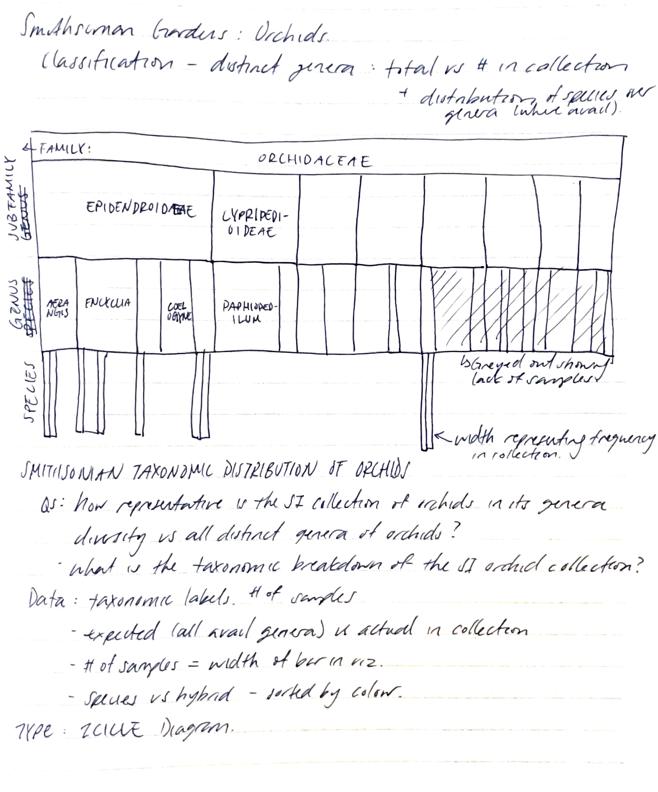
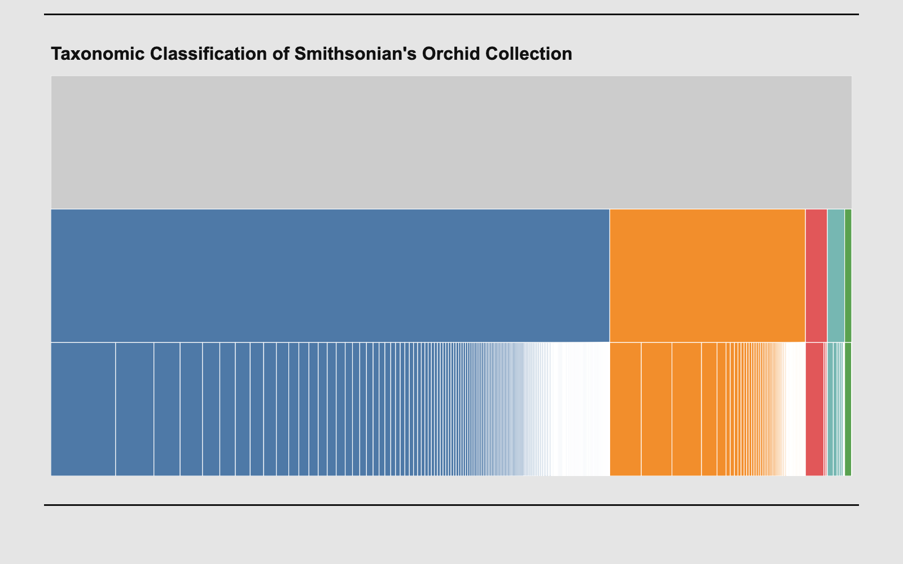

## Overview

<aside>Data48,786 specimens · 655 genera · Smithsonian Open Access.</aside>

Partnering with the Smithsonian for Major Studio 1, this project focuses on their Botany Collection of orchids with 48,786 specimens.

Orchids are one of the largest and most diverse plant families. This partition chart shows the Smithsonian’s orchid collection mapped against their taxonomic classification to visualize the diversity of the genera and the concentration of specimens in each. The long “Other” bar reveals that the genera with the fewest specimens hold the most species diversity.

## How data is encoded

- **Rows:** family, subfamily, genus. Kingdom, class and order are the same for every orchid, so they sit above the chart as a single line of descent.
- **Width:** number of specimens.
- **Genus bar height:** number of species.
- **Color:** subfamily.
- **Grey:** “Other,” grouped genera with fewer than 40 specimens in each.
- **Hover/tooltip:** specimen count, species count and the most common species.

## Process

Initial sketch of the data visualization and taxonomic hierarchy:

The first prototype grouped the data accordingly and formatted into the partition layout. However, every row was the same height, even though the information was not equally distributed across the rows: all orchids are from one family, then five subfamilies, and 655 genera which is the richest layer. Hundreds of small genera became hairlines on the chart. Labels also needed to be added.

This led to refinement of the final chart, where the genera row also encoded species data through the bar's height. This allowed another dimension of the data to be shown in the same amount of graphic space. The “Other” group allowed hairline values to be grouped and actually reveals where most diversity of the collection lies.

## Method

- Records come from the Smithsonian Open Access API and are queried by the orchid taxonomic name: `taxonomicName:"Plantae Monocotyledonae Asparagales Orchidaceae"`
- Each record’s taxonomic name is split into ranks following taxonomic classification (family, subfamily, genus, species).
- Uncertain names (cf., aff., sp., Indet., hybrids) stop at the last known rank.
- Records are nested with d3.group and laid out with d3.partition.
