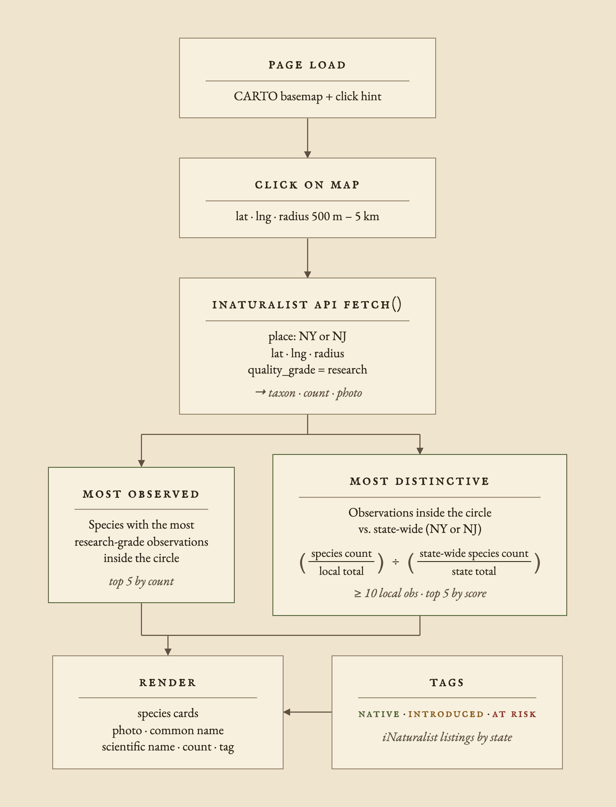
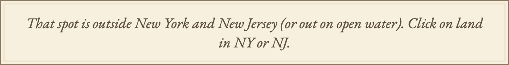
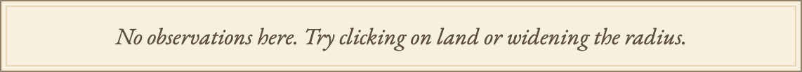

## Overview

SpeciesNYC is an interactive map for exploring species occurrence data in New York City through iNaturalist's API.

The project aims to connect people with the environment they live in by revealing encounters between people and nature in place. The interface invites exploration of biodiversity data and shows how people-nature-place relationships can be accessed digitally.

This project was inspired by Atlas of Living Australia's [Lens](https://www.ala.org.au/lens/) and [*Designing for biodiversity data in place*](https://doi.org/10.1002/pan3.70384) by Mitchell Whitelaw.

## Methodology

Clicking anywhere on the map returns two lists of five species within a set radius between 500m to 5km.

- **Most Observed:** species with the most observations inside the search circle.
- **Most Distinctive:** species more common inside the search circle than across the state.

Below is a flowchart of how the interface functions:

### Optimizing load speed

- State-wide totals load at startup.
- Search responses are cached by URL so repeat searches return instantly.
- A new click cancels the search in flight.
- Most Observed list renders first and distinctiveness scores and labels populate as their API requests return.

## UX Design

User testing resulted in the addition of the cursor hint on page load for first-time users.

Once a click occurs, the searched circle stays visible on the map to retain the geospatial context of species with the place in which they were observed.

On desktop, the species panel slides in from the right and the search circle recenters on the open map on the left.

On mobile, the panel is a bottom sheet over 65% of the screen, and the search circle recenters in the strip of map above.

On both, the map zooms out if the circle is too large to fit.

If the user clicks on open water or outside New York or New Jersey, one of the following messages appears instead of an empty list.

